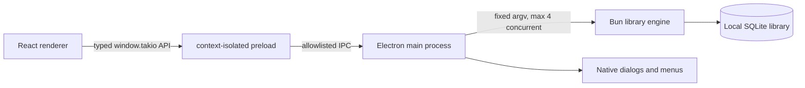

# Electron migration

Takio moved from Tauri to Electron as a clean pre-release cutover. There are no
customer installations or production libraries that require a dual-runtime
period, compatibility shim, or in-place application migration.

## Critique of the Tauri version

The previous app had strong product depth but weak product hierarchy. It already
contained the valuable parts worth preserving: a local-first library, a typed
command seam, a standalone Bun sidecar, server-shaped catalogue queries,
accessible three-pane library tooling, native menus, drag-and-drop import,
device delivery, and a durable conversion queue.

The shell worked against those strengths. A dark marketing-style frame competed
with a dense white workspace, the import hero consumed prime space on every
launch, the one-item navigation did not clarify the application model, and the
Tauri Rust layer mostly repeated validation before forwarding fixed arguments to
the existing CLI engine. That added a second implementation language and release
toolchain without adding meaningful domain behavior.

## New architecture

- The renderer has no Node integration and cannot call arbitrary IPC channels.
- The preload exposes only library invocation, native dialogs, path helpers,
  menu events, and dropped-file path resolution.
- The main process preserves the sidecar protocol limits: fixed command mapping,
  16 KiB JSON arguments, 8 MiB output caps, four concurrent invocations, and
  exit-code/result consistency checks.
- Managed covers use a custom protocol restricted to image files below Takio's
  data root.
- Electron Builder packages the renderer, main process, preload, and compiled Bun
  sidecar. Rust and Cargo are no longer part of the desktop toolchain.

## Product changes

The retained three-pane library is now the visual center of the application.
Import is a primary toolbar action and a compact drop target. Reader controls and
the conversion queue form a utility rail. The warm editorial theme treats the
collection as a personal archive rather than a generic admin dashboard.

## Cutover

1. Remove `apps/desktop/src-tauri` and all Tauri dependencies.
2. Build the sidecar at `apps/desktop/resources/bin/takio-library-engine`.
3. Run `bun run desktop` for development.
4. Run `bun run --filter '@takio/desktop' package:dir` for an unpacked smoke-test
   app, or `bun run --filter '@takio/desktop' package` for installers.
5. Keep the existing library data location and schema. The application runtime
   changed, not the library contract.

Because this is a pre-release cutover, no Tauri detection, import wizard, or
fallback binary is shipped. Git history is the rollback path for application
code. Library backup and schema-forward rules remain unchanged.
