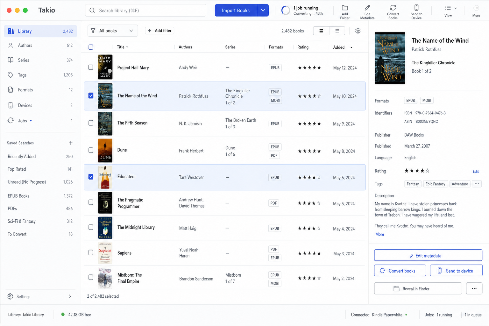

# Calibre-Competitive Product Roadmap

> Current product direction. This supersedes the strategic scope in
> `claude-fable-5-product-roadmap.md`; historical implementation plans remain
> snapshots of their original milestones.

## Product contract

Takio is a local-first, Calibre-competitive library, metadata, conversion, and
device-management application with a modern macOS workspace and deterministic
CLI. Reading stays in external applications.

The implementation continues to use Calibre executables for ebook conversion,
metadata extraction, polishing, and optional external editing. Takio does not
build a second conversion engine.

## Visual direction

- **Visual thesis:** quiet technical library; cool white and graphite surfaces,
  compact editorial typography, restrained indigo accent, and book covers as
  the only strong color.
- **Workspace:** library facets on the left, a dense sortable book table in the
  center, and a persistent metadata/formats inspector on the right.
- **Interaction:** selection-aware actions, keyboard navigation, fast row and
  inspector transitions, visible focus, and truthful progress/status.
- **Container model:** open shell, rails, table, dividers, and one inspector;
  routine product UI does not use a dashboard card grid.

## Delivery horizons

### 0. Verified baseline

Keep documentation aligned with executable behavior and add reproducible CI.
Takio currently has an owned-file SQLite library, basic metadata/covers/tags,
macOS mounted-volume transfer, EPUB-to-PDF conversion through Calibre, and a
durable foreground conversion ledger.

### 1. Book-centered data foundation

- One logical book owns multiple format files.
- Multiple authors, series/index, publisher, identifiers, languages, published
  date, rating, description, tags, cover, and timestamps.
- Explicit format attach/remove and collision-safe book merge.
- Lossless schema migration with verified backup and rollback.
- Completed conversions attach to their source book.

Exit: an existing library migrates without loss, and one converted book appears
once with both EPUB and PDF formats.

### 2. Competitive library workspace

- Recursive and multi-file import with embedded metadata and filename fallback.
- Exact-file duplicate detection and explicit review of ambiguous matches.
- Dense sortable multi-select table, facets, saved views, and persistent book
  inspector.
- Bulk metadata, tags, conversion, export, send, and removal.
- Keyboard-complete operation and accessible status/error announcements.

Exit: import, find, select, edit, merge, convert, and send work without opening
the filesystem. At 1280x800 the library and search are immediately visible and
at least eight rows fit. With 10,000 seeded books and at least 15,000 formats,
paging, filtering, and sorting stay database-backed; warm query-plus-facet-plus-
sort p95 is at most 150 ms for the first 100 results, launch-to-usable is at most
two seconds, and a saved view restores its query, facets, and sort after relaunch.

Verified baseline: the 10,000-book/15,000-format fixture measured 110.1 ms p95
for the database-backed query gate. The production-optimized macOS app measured
1,142.0 ms from executable spawn through saved-view resolution and the first
successful catalogue query. Browser acceptance at 1280x800 fit nine complete
rows; saved-view restoration, contiguous multi-selection, keyboard row
navigation, modal focus return, bulk metadata fields, and external-only Open
actions passed without console errors. At the supported 900x620 minimum, five
complete rows remain visible while secondary panels stay reachable.

### 3. Conversion and device daily driver

- Advertise only conversion pairs proven against a real Calibre backend.
- Add EPUB-to-AZW3 and DOCX/HTML/TXT-to-EPUB before broader pairs.
- Automatically drain queued work while the desktop is open.
- Progress when available, active cancellation, explicit retry, and truthful
  interrupted-job recovery.
- Prefer an existing compatible format for a connected device; convert and
  attach a new one only when necessary.

Exit: one Send action chooses or creates the right tested format, and real Kobo
and mass-storage Kindle acceptance records include hashes and remount results.

### 4. Power library and public distribution

- Structured and saved searches, virtual libraries, multiple physical
  libraries, save-to-disk templates, and discovery indexing.
- Trash/restore, integrity checks, complete export/import, and database rebuild.
- Signed/notarized macOS packages, signed updates, exercised rollback, and
  whole-library backup/restore.
- Windows, Linux, MTP, wireless, and email delivery only after their independent
  release and hardware gates pass.

### 5. Demand-gated ecosystem

- Ebook polish and validation using Calibre tools.
- External Calibre editor handoff through verified copies.
- Download-only authenticated content server; never browser reading.
- News/RSS, catalogs, store search, and plugins only after concrete demand
  proves each extension seam.

## Permanent exclusions

- Built-in reader, browser reader, reading progress, highlights, annotations,
  and bookmarks.
- DRM removal.
- A Takio-owned conversion engine.
- Cloud accounts, real-time collaboration, or automatic destructive sync.
- Claims to support unverified formats, devices, platforms, or hostile-input
  sandboxing.
- Plugin infrastructure before two real integrations require the same seam.

## Competitive acceptance journey

Import a folder, account for every accepted/merged/skipped/failed file, review
metadata and duplicates, find books using search and facets, save a view, bulk
edit tags, convert a book, see the new format on the same book, send the right
format to a connected reader, relaunch, and observe identical data and state.

Every implementation commit must leave relevant focused tests green. Every
integration commit must pass `bun run check`, `bun run test`, and
`bun run build`; Rust bridge changes must also pass native Cargo tests using the
current Apple SDK/linker.
